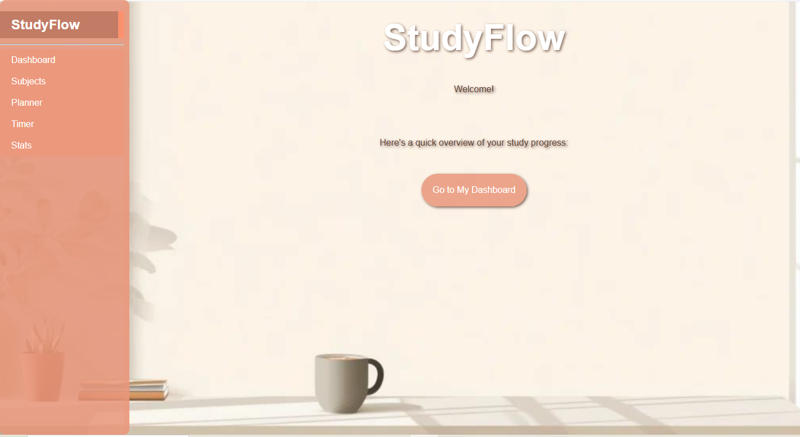
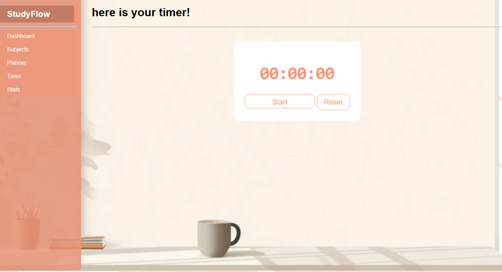
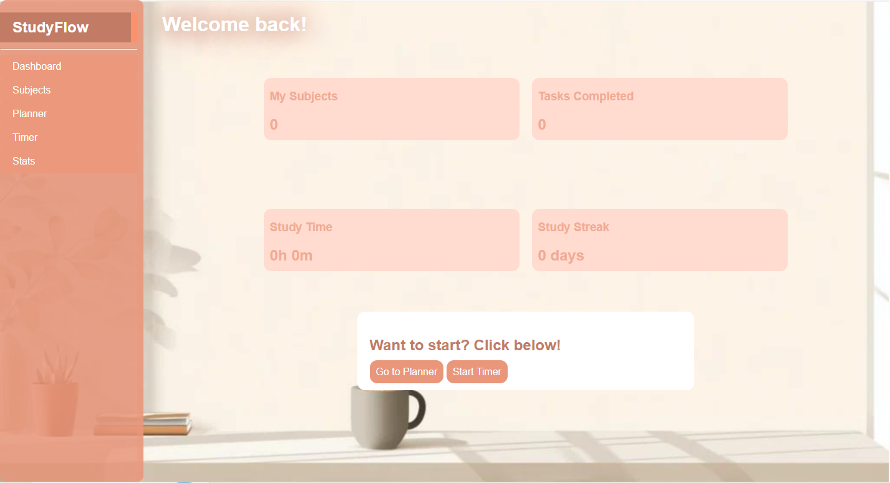
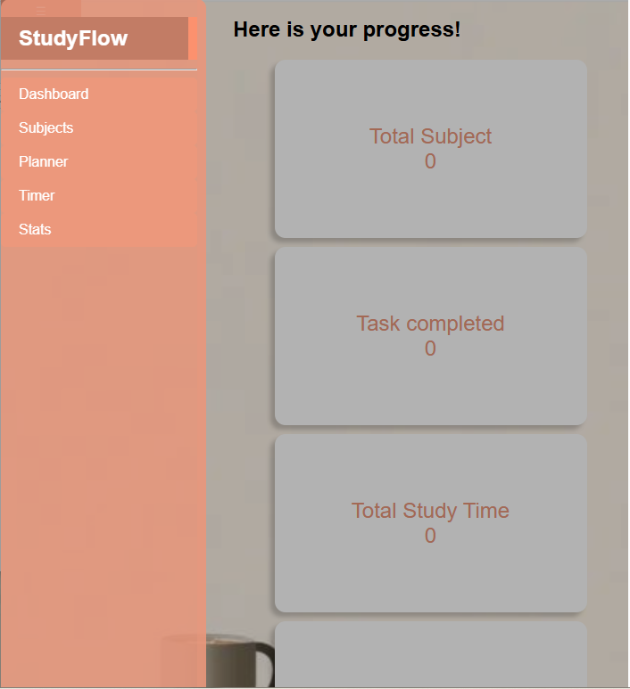
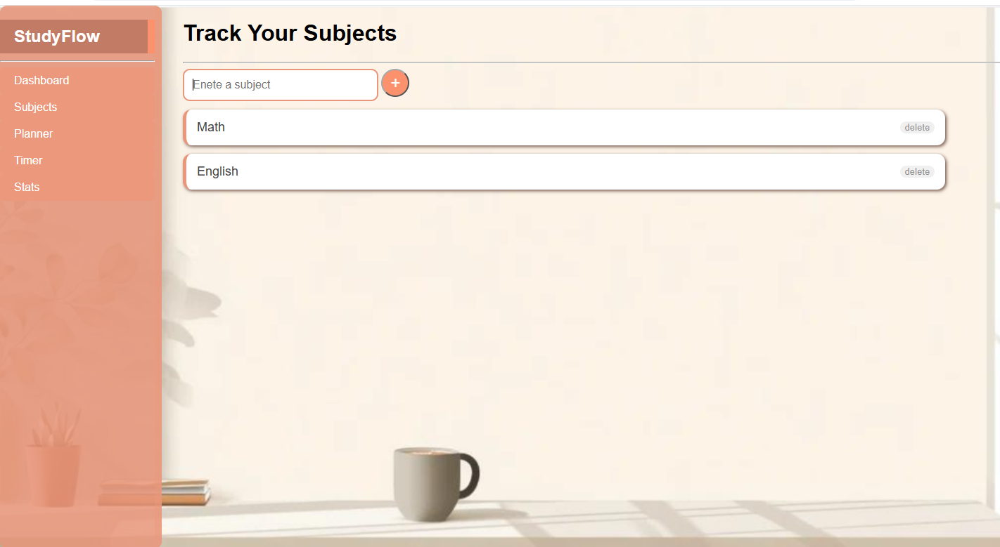
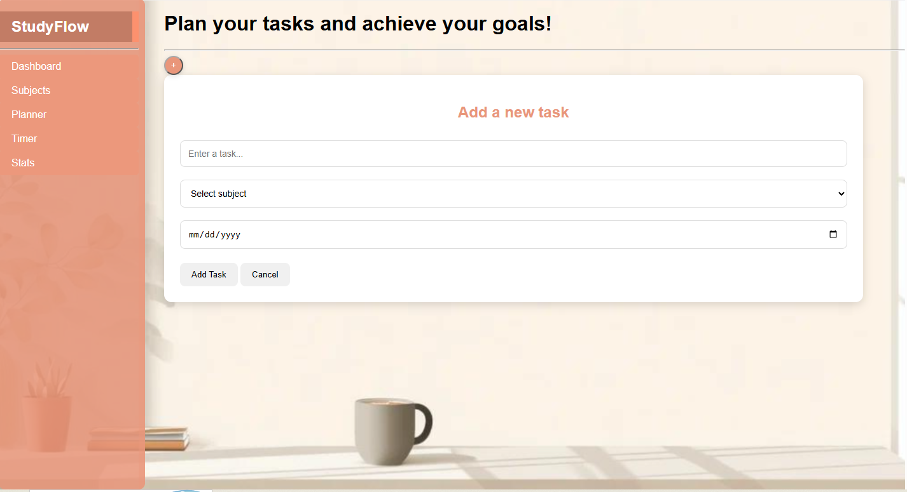

**StudyFLow**

StudyFlow is a website where you can plan, organize and track your activities neatly. It is built to make students' school load less. The website is built only in front-end, so the data the user entered won't be stored.

*Its purpose*

The first one is organization. organized materials feel light to study and encourage us to study well and studyflow is created for that. The second thing is for managing time. the timer helps to track the time students studied. And all of them will be tracked when the website's back-end is built.

*Its feature:*

it has planner where students can put their planned activities. it also has timer, to mange time.
 Their activities will be saved in dashboard so they can track down what they have done. but this feature isn't available for now because it doesn't have storage. Not only the dashboard, it also has stats where they can visualize what they have done.
 

it's got planner. students can write their daily to-do-list and save the subjects they study to know how much they studied on a specific subject.   

how it is built:

The website is built in 12 hours of coding and many hours of studying. It used 3 languages which are important to front-end. From the three Java script was hard, but to make interactive and help students well, I studied js and learned the basics. In that way the project was done in 1 week. but it's notcomplete.
*Languages Used:*

This website is built with HTML,

CSS to style it and 

Java script to make it interactive.

All what the user need is to visit the site, navigate every features and use them well.
*For the Future:*

The website has only front-end features. It needs back-end to save data. So this project will be updated soon with storage.
If it is possible, the website will have more cool and advanced features that can be more useful to students.

Want to try it:

here is the demo link:   sbt2-glitch.github.io/StudyFlow/
